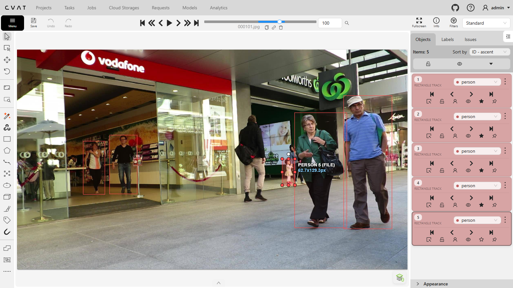
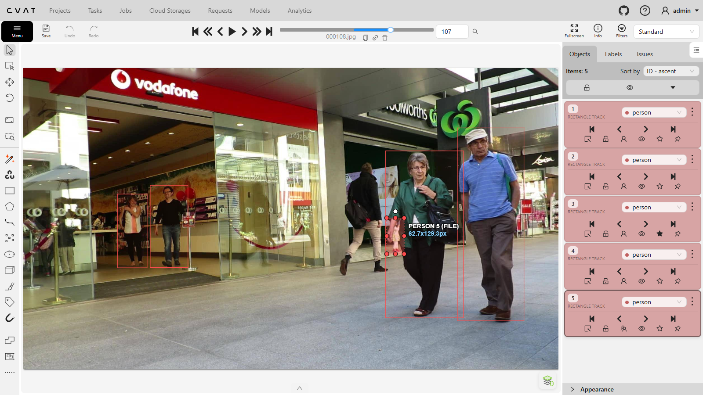
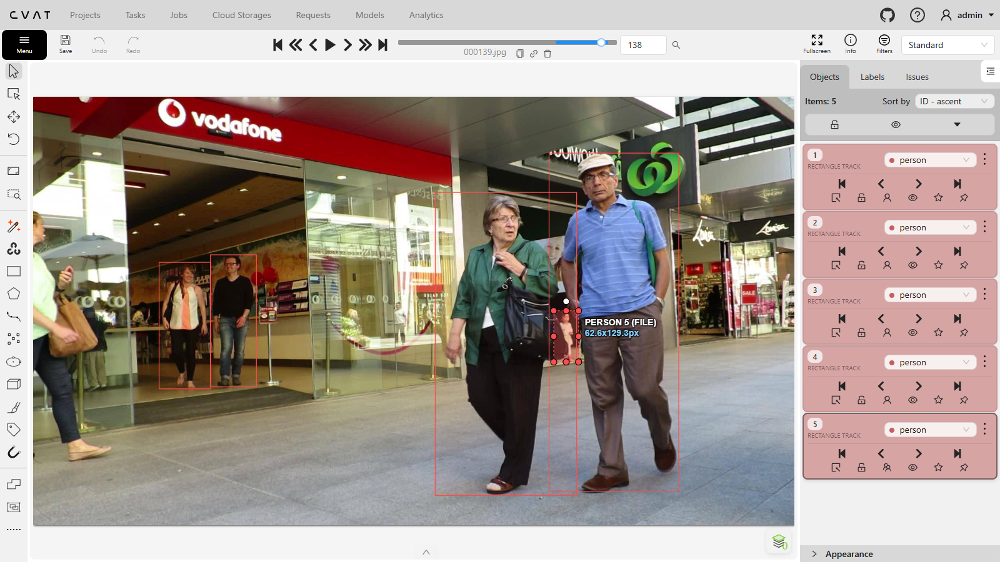

# Báo cáo cá nhân — PhamHuynh-2A202603135

Đoạn video: MOT17-09, 150 frame (frame 1–150), nguồn MOTChallenge, giấy phép CC BY-NC-SA 3.0.

## 0. Thông tin học viên

- Họ tên: Phạm Huỳnh
- MSSV: 2A202603135
- Mã đề (A/B/C): A
- Email: phamhuynhmk1@gmail.com
- Link repository: https://github.com/phamhuynhmk1-png/K5-L2-DAY05-PhamHuynh-2A202603135-MOTTracking
- Giờ bắt đầu: 16:41 ngày 13/11/2026
- Giờ kết thúc: 20:00 ngày 13/11/2026

## 1. Xem trước đoạn video (CP0)

Ghi **trước khi vẽ**, mỗi người một dòng.

| Mã | Frame xuất hiện | Frame cuối thấy được | Rẽ / dừng / đổi tốc độ ở frame | Bị che ở frame | Ghi chú |
|---|---|---|---|---|---|
| P1 | 0 | 149 | Dừng ~100, quay lại đi sang trái ~110 | 30–39 (một phần), 40–49 (khuất hẳn), 50–59 (một phần) | Người trong shop Vodafone |
| P2 | 60 | 149 | Đi nhanh sang phải 60–80, chậm dần 80–110, dừng ~110, đổi hướng về phía camera ~120 | 60–69 (một phần) | Người trong shop Vodafone, xuất hiện từ frame 60 |
| P3 | 0 | 149 | Đi đều về phía camera, nhanh lên từ ~100 | | Đi về phía camera, box to dần |
| P4 | 0 | 149 | Đi đều về phía camera, nhanh lên từ ~100 | | Frame 0–~24 bị mép phải khung hình cắt (không phải bị che) |
| P5 | 0 | 145 | Đi chậm sang phải 0–40, đứng yên từ ~40 | 105–109 và 136–139 (một phần), 110–135 (khuất hẳn), 143–145 (một phần), 146–149 (khuất hẳn) | Bị P3 rồi P4 đi ngang che |

## 2. Keyframe và thời gian (CP1, CP4)

Số keyframe lấy từ kết quả `src/check_submission.py`.

| Mã | Số keyframe | Keyframe ở frame | Số frame có mặt | Keyframe / 100 frame | Thời gian (phút) | Chỗ khó |
|---|---|---|---|---|---|---|
| P1 | 18 | 0, 10, 20, 30, 50, 60, 69, 70, 76, 80, 90, 100, 110, 118, 120, 130, 140, 149 | 140 | 12.9 | 15 | Bị người đi ngang che 30–59 |
| P2 | 22 | 60, 70, 72–75, 77–81, 90, 100, 110, 112, 114–116, 120, 130, 140, 149 | 90 | 24.4 | 15 | Xuất hiện sau, bị che lúc đầu |
| P3 | 53 | 0, 10, 20, 30, 33, 38, 40, 41, 43, 50, 53, 56, 59, 60, 70, 80, 82, 87, 90–94, 96–105, 107, 108, 110, 114–116, 118–120, 122–125, 128–131, 133, 140, 149 | 150 | 35.3 | 25 | Box to dần, đi nhanh từ ~100 |
| P4 | 47 | 0, 7, 10–13, 15–18, 26, 36, 43, 53, 62, 70, 72, 75–78, 85, 88, 95, 99, 100, 104, 108, 111, 115, 119, 121–123, 125–127, 130, 132, 134, 137, 139, 141, 142, 145, 148, 149 | 150 | 31.3 | 30 | Bị mép khung cắt lúc đầu |
| P5 | 10 | 0, 10, 20, 30, 40, 105, 136, 140, 142, 143 | 120 | 8.3 | 20 | Bị che hai lần ở cuối |
| **Tổng** | 150 | | 650 | 23.1 | 105 | |

Keyframe / 100 frame của cả bài = tổng keyframe ÷ tổng số frame có mặt × 100 = 150 ÷ 650 × 100 = 23.1

Bạn đặt keyframe nhiều nhất ở người nào? Vì sao (người đó rẽ, dừng, lại gần camera hay bị che)?

P3 (53 keyframe). P3 đi thẳng về phía camera nên box to dần liên tục, và từ khoảng frame 100 bà đi nhanh hơn, tay và túi xách đung đưa làm bề rộng box đổi nhiều; vì vậy keyframe dồn ở đoạn 90–133. P4 lúc đầu có tới 117 keyframe (đặt gần như mỗi frame) do vừa bị mép khung cắt vừa đi lại gần camera; sau khi tự kiểm đã giảm còn 47.

## 3. Đoạn bị che (CP2)

Người bị che: `P5`

| Mốc | Frame |
|---|---:|
| Bắt đầu bị che một phần (bật `occluded`) | 105 |
| Mất hẳn (bật `outside`) | 110 |
| Hiện lại (tắt `outside`) | 136 |
| Thấy rõ trở lại (tắt `occluded`) | 140 |

- Thời gian khuất hẳn: 26 frame (110–135) = khoảng 0,87 giây (MOT17-09 quay 30 fps).
- Quyết định: giữ cùng ID.
- Lý do (trả lời 3 câu: khuất bao lâu so với 60 frame, ngoại hình có khớp, chỗ hiện lại có đúng hướng và tốc độ):

  - Khuất 26 frame, ngắn hơn ngưỡng 60 frame.
  - Ngoại hình khớp: vẫn là bé gái váy trắng, giày hồng.
  - Hiện lại đúng chỗ cũ trước cửa hàng Woolworths; bé gần như đứng yên nên vị trí và tốc độ khớp.

Ảnh chụp màn hình:





Ảnh lần lượt ở frame 100 (P5 còn thấy rõ), 107 (box P5 nét đứt, cờ `occluded` bật trên dòng object số 5) và 138 (P5 hiện lại sau P3, vẫn là object số 5). Nguồn ảnh: MOT17, MOTChallenge (Milan et al., 2016).

## 4. Tự review ID (CP3)

Lượt 1 theo người (đi ngược từ frame 149 về 0 trên CVAT), lượt 2 theo cảnh (nhảy 10 frame). Ít nhất 3 dòng; không có lỗi thì ghi một dòng "đã kiểm hai lượt, không lỗi".

Loại lỗi dùng đúng một trong 7 mã: `id_switch`, `fragmentation`, `lost`, `merge`, `false_track`, `drift`, `flag`.

| Frame | Mã người | Loại lỗi | Mô tả một câu | Phát hiện ở lượt | Đã sửa? |
|---:|---|---|---|---|---|
| 0–16 | P4 | `lost` | Ban đầu định bắt đầu track P4 từ frame 17, trong khi từ frame 0 đã thấy vai và tay áo xanh ở mép phải | 1 | Có, track P4 bắt đầu từ frame 0 |
| ~140 | P5 | `drift` | Box P5 bị lỡ xoay 0,7° khi kéo nhầm nút xoay, box lệch khỏi dáng người | 1 | Có, đưa góc về 0° |
| 0–149 | Cả 5 | – | Lượt 2: soát 16 frame (0, 10, …, 140, 149), cả 5 box bám đúng người, không đổi ID, không thừa/thiếu box | 2 | Không cần sửa |

Tổng hợp số lỗi theo loại:

| `id_switch` | `fragmentation` | `lost` | `merge` | `false_track` | `drift` | `flag` |
|---:|---:|---:|---:|---:|---:|---:|
| 0 | 0 | 1 | 0 | 0 | 1 | 0 |

Lỗi nào chỉ lượt 2 (theo cảnh) mới thấy, lượt 1 (theo người) không thấy? Vì sao?

Không có lỗi nào chỉ lượt 2 mới thấy. Hai lỗi trên đều nằm trong một track (thiếu box ở đầu track, box bị xoay) nên đi theo từng người là thấy. Lượt 2 hợp để bắt lỗi giữa hai người như `id_switch` hay `merge`, ví dụ đoạn P3 và P4 đi sát nhau ở frame 110–149, nhưng đoạn này đã kiểm và không có lỗi.

## 5. File xuất và kết quả tự kiểm (CP4)

| Kiểm tra | Kết quả |
|---|---|
| Tên file MOT 1.1 | `src/exports/PhamHuynh_mot.zip` |
| Tên file CVAT for video 1.1 | `src/exports/PhamHuynh_cvat_video.zip` |
| Số track ID khác nhau trong `gt/gt.txt` (phải là 5) | 5 |
| Frame `outside` không có dòng trong `gt.txt` (đúng / sai) | Đúng (P5: không có dòng nào ở frame_id 111–136, tức frame CVAT 110–135) |
| Job đã completed trên CVAT máy cá nhân | Có (job #17, state = completed) |

Dán phần tóm tắt in ra từ `src/check_submission.py`:

```text
=== File MOT 1.1: PhamHuynh_mot.zip ===
  Số track ID: 5   |   Tổng số box: 650
  [OK]        Đúng 5 track ID.
  [CẢNH BÁO]  Track 3: chiều cao box đổi > 30% trong 1 frame ở frame [11].

=== File CVAT for video 1.1: PhamHuynh_cvat_video.zip ===
  Tổng: 150 keyframe / 650 frame có mặt = 23.1 keyframe / 100 frame
  [OK]        Đọc được 5 track từ annotations.xml.

=== Tóm tắt ===
  Lỗi: 0   |   Cảnh báo: 1
```

Giải thích cảnh báo: track 3 là P4. Ở frame 11, P4 đang bước vào từ mép phải và chân vừa lộ ra, nên box cao lên từ khoảng 172 px lên 245 px. Đây là box đúng theo phần người mới xuất hiện, không phải co giật.

## 6. Ba câu kết

1. Nếu được gán lại, bạn sẽ đặt keyframe khác ở đâu? Vì sao?

   Với P4, chỉ đặt dày ở đoạn bước vào từ mép phải (frame 0–30, cách 3–5 frame) và quanh chỗ đổi tốc độ ở khoảng frame 100; đoạn đi thẳng thì để CVAT nội suy, khoảng 10 frame một keyframe. Lần đầu em đặt gần như mỗi frame (117 keyframe) mà box cũng không chính xác hơn bao nhiêu.

2. Có chỗ nào bạn không chắc "cùng ID hay ID mới"? Bạn đã quyết định và ghi chú thế nào?

   Có, P5 khuất hẳn 26 frame (110–135) sau lưng P3. Em giữ cùng ID: thời gian khuất dưới 60 frame, bé vẫn mặc váy trắng giày hồng, và hiện lại đúng chỗ cũ vì bé đang đứng yên. Ghi ở mục 3. P1 khuất 10 frame (40–49) cũng giữ cùng ID với lý do tương tự.

3. Một lỗi ID trong job của bạn (nếu không còn sót, chọn lỗi đã sửa) có thể làm xe tự lái dự đoán sai chuyển động của người đó như thế nào? Lỗi đó ảnh hưởng MOTA hay IDF1 nhiều hơn?

   Chọn lỗi `lost` đã sửa ở P4: nếu bỏ trống frame 0–16, mô hình học từ nhãn này sẽ coi như P4 "đột ngột xuất hiện" ở frame 17 ngay sát P3, nên không có lịch sử chuyển động để dự đoán ông đang đi về phía camera. Xe sẽ phản ứng chậm với một người đã ở đó từ trước. Lỗi này là 17 frame thiếu box (FN), nên ảnh hưởng MOTA nhiều hơn; IDF1 cũng giảm nhưng ít hơn vì ID của P4 vẫn giữ nguyên suốt phần còn lại.

## Bonus (nếu làm)

### B1 — Hai người đi sát

...

### B2 — So cách đặt keyframe

| Cách đặt | Số keyframe | Frame trôi nhất | Ghi chú |
|---|---:|---:|---|
| Đều mỗi 30 frame | | | |
| Theo chỗ đổi hướng | | | |

...

### B3 — So với tracker có sẵn

| Frame | Mã người | Tracker làm gì | Nhãn của bạn | Giải thích (đoán rồi sửa / ghép IoU / box score thấp / ngoại hình) |
|---:|---|---|---|---|
| | | | | |
| | | | | |

## 7. Tài liệu tham khảo và công cụ AI đã dùng
